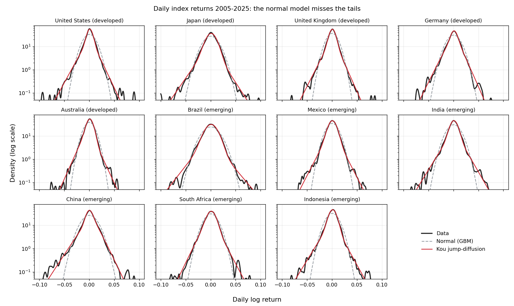

# Jumps and Volatility in Developed and Emerging Stock Markets

How fat are the tails of daily stock returns, how much of that comes from sudden jumps rather than shifting
volatility, and do emerging markets jump differently from developed ones?

This repository fits five models to daily index returns for **11 markets, 2005–2025**: five developed (United States,
Japan, United Kingdom, Germany, Australia) and six emerging (Brazil, Mexico, India, China, South Africa,
Indonesia).

| Model | What it captures |
|---|---|
| Geometric Brownian motion (GBM) | Normal returns with constant volatility, the Black–Scholes benchmark |
| Merton (1976) jump-diffusion | GBM plus normally distributed jumps |
| Kou (2002) jump-diffusion | GBM plus double-exponential jumps, with separate rates for up and down jumps |
| GARCH(1,1) | Volatility clustering: calm and turbulent periods, no jumps |
| GARCH(1,1) with jumps | Volatility clustering and jumps estimated together |



## Main findings

1. **Tails are fat everywhere.** Excess kurtosis ranges from 4.8 (South Africa) to 13.2 (United States). A normal
   model understates the 1% one-day Value at Risk by 9% to 45%, most of all in China (45%) and Indonesia (36%).
2. **Volatility clustering matters more than jumps.** In every market GARCH(1,1) improves the log-likelihood over
   GBM by more than either jump-diffusion does, with fewer parameters. Constant-volatility jump models "explain"
   fat tails partly by mistaking turbulent periods for jumps: the fitted Kou model implies 70–280 jumps a year.
3. **Jumps remain once clustering is allowed for.** Adding jumps to GARCH raises the log-likelihood by 44 to 204
   points for three extra parameters, a highly significant gain in every market. Jumps then account for 11–29% of
   return variance, and the average jump is negative everywhere. GARCH with jumps has the lowest BIC of the five
   models in all 11 markets.
4. **Emerging markets differ in the kind of jumps, not their share.** China, Brazil, India and Indonesia have rarer
   but larger jumps: 1.6 to 4.5 jumps of more than 3% a year after controlling for volatility. The US, UK,
   Germany, Mexico and South Africa have frequent small jumps and 0.2 or fewer large ones. Japan is in between
   (0.9). "Emerging" is not one category: Mexico and South Africa look like developed markets.

| Market | Group | Annual vol. | Excess kurtosis | 1% VaR, data | 1% VaR, normal | Normal understates by | Log-lik. gain: Kou vs GBM | GARCH vs GBM | GARCH+jumps vs GARCH | Jumps > 3% a year | Jump share of variance | Mean jump |
|---|---|---|---|---|---|---|---|---|---|---|---|---|
| United States | Developed | 19% | 13.2 | 3.5% | 2.8% | 27% | 966 | 1461 | 163 | 0.2 | 17% | -0.6% |
| Japan | Developed | 23% | 8.9 | 4.1% | 3.3% | 21% | 515 | 772 | 81 | 0.9 | 22% | -0.4% |
| United Kingdom | Developed | 17% | 10.7 | 3.2% | 2.5% | 27% | 737 | 1120 | 99 | 0.2 | 17% | -0.4% |
| Germany | Developed | 21% | 8.4 | 3.8% | 3.0% | 26% | 592 | 876 | 117 | 0.2 | 29% | -0.3% |
| Australia | Developed | 17% | 7.9 | 3.0% | 2.4% | 25% | 552 | 956 | 78 | 0.0 | 15% | -1.6% |
| Brazil | Emerging | 26% | 9.6 | 4.1% | 3.8% | 9% | 486 | 773 | 65 | 2.2 | 11% | -0.8% |
| Mexico | Emerging | 18% | 6.1 | 3.4% | 2.7% | 27% | 450 | 734 | 86 | 0.2 | 18% | -0.4% |
| India | Emerging | 21% | 12.4 | 3.9% | 3.0% | 28% | 723 | 1174 | 77 | 1.6 | 15% | -0.4% |
| China | Emerging | 24% | 5.6 | 5.0% | 3.4% | 45% | 670 | 861 | 204 | 4.5 | 26% | -0.7% |
| South Africa | Emerging | 20% | 4.8 | 3.4% | 2.9% | 16% | 365 | 733 | 44 | 0.1 | 20% | -0.3% |
| Indonesia | Emerging | 20% | 9.0 | 3.8% | 2.8% | 36% | 679 | 927 | 145 | 1.6 | 19% | -0.8% |

The jump columns come from the GARCH-with-jumps model. Full estimates are in [`results/`](results).

## Contents

| File | What it does |
|---|---|
| [`get_prices.py`](get_prices.py) | Downloads daily adjusted closes from Yahoo Finance into `data/` (exchange-local dates) |
| [`jump_diffusion.py`](jump_diffusion.py) | Densities, simulators, starting values and maximum-likelihood fitting for all five models |
| [`run_analysis.py`](run_analysis.py) | Fits every model to every market, checks parameter recovery, writes `results/` and `figures/` |
| [`results/summary.csv`](results/summary.csv) | One row per market: tails, model comparison, jump characteristics |
| [`results/model_comparison.csv`](results/model_comparison.csv) | Log-likelihood, AIC and BIC for each model and market |
| [`results/parameters.csv`](results/parameters.csv) | All parameter estimates, with re-estimates on a simulated path |
| [`results/tails.csv`](results/tails.csv) | Kurtosis, skewness, large falls and 1% VaR: data against simulations from each model |
| [`matlab/`](matlab) | The original MATLAB implementation of the Merton and Kou models (single market) |

## Running it

```bash
pip install numpy scipy pandas matplotlib
python get_prices.py ^GSPC ^N225 ^FTSE ^GDAXI ^AXJO ^BVSP ^MXX ^BSESN 000001.SS ^J200.JO ^JKSE \
    --start 2005-01-01 --end 2026-01-01
python run_analysis.py          # about 25 minutes on a laptop
python run_analysis.py --replot # redraw figures from saved estimates
```

## Method

- **Data.** Daily closing levels of each market's main index in local currency, January 2005 to December 2025
  (about 5,100–5,300 trading days per market). Returns are daily log changes. Index levels are price indices, so
  dividends are excluded; this barely affects daily return distributions.
- **Estimation.** Maximum likelihood with Nelder–Mead (the algorithm behind MATLAB's `fminsearch`), restarted from
  its own optimum. The Merton density is a Poisson mixture of normals. The Kou density is computed **exactly** by
  Fourier inversion of its characteristic function. Kou's widely used one-jump approximation breaks down at the
  jump rates found in the data (it is off by about 13% when there are ~180 jumps a year); the approximate
  version is kept in `kou_pdf_approx` for comparison.
- **GARCH with jumps.** Daily returns are `c + sqrt(h_t) z_t + J_t`, where `J_t` is a Poisson number of normal
  jumps and `h_t` follows a GARCH(1,1) driven by the total shock. The jump share of variance is
  `λ(μ_j² + σ_j²)` divided by total unconditional variance.
- **Checks.** The corrected densities integrate to one and match histograms of simulated returns. Each jump model
  is re-estimated on a path simulated from its own fit; the re-estimates are close to the originals in every
  market (see `parameters.csv`), so the parameters are identified.

## Limitations

- Jumps are inferred statistically from daily closes, not identified from news. Some "jumps" in the
  GARCH-with-jumps model are better read as fat-tailed shocks than as discrete events.
- Parameters are assumed constant over 21 years. Jump risk is likely to vary with the market regime.
- Australia's jump-size dispersion is estimated at zero: its jumps are fitted as a fixed fall of about 1.6%,
  which is why it shows no jumps above 3%.
- Shocks in the GARCH models are normal; Student-t shocks would absorb some of what is attributed to jumps here.

## History

This repository began in 2018 as a MATLAB implementation of the Merton and Kou models for a single index (now in
[`matlab/`](matlab)). In October 2026 it was converted to Python, the Kou functions were corrected (the density used
`normalize` where the normal CDF is needed and had a sign error, and the simulator drew normal rather than
double-exponential jumps), the exact Kou density and the GARCH models were added, and the analysis was extended
to 11 markets.

## References

- Merton, R. C. (1976). Option pricing when underlying stock returns are discontinuous. *Journal of Financial
  Economics*, 3(1–2), 125–144.
- Kou, S. G. (2002). A jump-diffusion model for option pricing. *Management Science*, 48(8), 1086–1101.
- Bollerslev, T. (1986). Generalized autoregressive conditional heteroskedasticity. *Journal of Econometrics*,
  31(3), 307–327.
- Maheu, J. M. and T. H. McCurdy (2004). News arrival, jump dynamics, and volatility components for individual
  stock returns. *Journal of Finance*, 59(2), 755–793.

## Author

**Samuel Edet** · [samueledet.github.io](https://samueledet.github.io)
